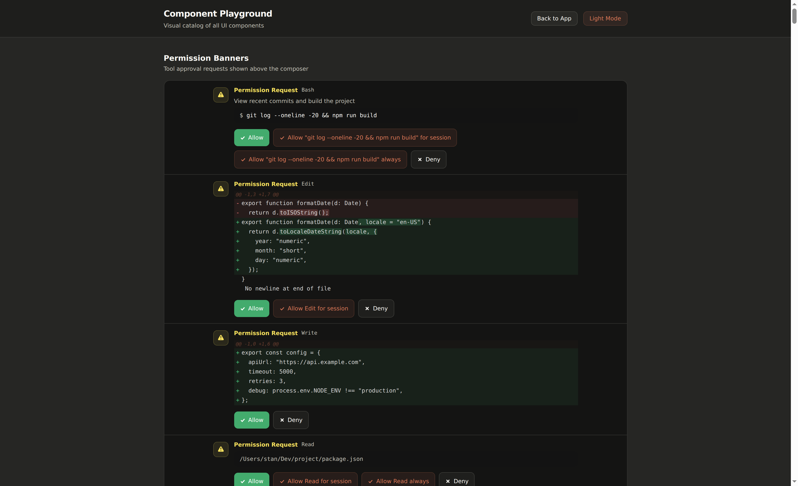

# Installation

## Quick install (Ubuntu, macOS, Windows)

One path for every machine — your laptop or a server.

### 0. Windows only: install WSL2

Aura Companion runs on Windows inside WSL2 (Ubuntu). Open PowerShell **as Administrator**:

```powershell
wsl --install -d Ubuntu
```

Restart Windows if asked, then open **Ubuntu** from the Start menu. Run every following step in that Ubuntu window. Your Windows browser reaches the server at `http://localhost:3456` automatically.

### 1. Install Bun, Node.js and an agent CLI

```bash
# Bun
curl -fsSL https://bun.sh/install | bash
source ~/.bashrc          # macOS: source ~/.zshrc

# Node.js (for npm) — Ubuntu / WSL2, if `npm` is missing
sudo apt-get update && sudo apt-get install -y nodejs npm git

# Claude Code and/or Codex
npm install -g @anthropic-ai/claude-code
npm install -g @openai/codex
```

On Ubuntu, if `npm install -g` fails with `EACCES`, prefix it with `sudo`.

### 2. Start Aura Companion

```bash
bunx aura-companion
```

### 3. Open the browser and sign in

Open [http://localhost:3456](http://localhost:3456). The first-run wizard shows whether each CLI is installed and signed in; click **Sign in to Claude Code** / **Sign in to Codex** and finish the sign-in in the browser. No terminal login is needed. If a CLI is missing, the wizard shows the install command and a **Check again** button.

You can also sign in from a terminal: `bunx aura-companion auth login claude` (or `codex`), and check the result with `bunx aura-companion auth status`.

### 4. Optional: run in the background

```bash
bunx aura-companion install     # launchd (macOS) or systemd --user (Linux, WSL2 with systemd)
bunx aura-companion status
```

On WSL2 the background service needs systemd enabled — see [Microsoft's guide](https://learn.microsoft.com/windows/wsl/systemd).

### Codex: subscription vs API key

The wizard's sign-in uses your ChatGPT subscription (Plus / Pro / Team) — usage counts against the subscription, not the per-token API bill. To bill an OpenAI API key instead, open **Advanced: use an OpenAI API key instead** in the wizard, or set `OPENAI_API_KEY` before starting the server. If both exist, the subscription sign-in wins.

## Run from source (contributors)

```bash
git clone https://github.com/antonioshaman/aura-companion.git
cd aura-companion/web
bun install
bun run dev             # http://localhost:5174 with hot reload; backend on :3457
```

Production-style build from source:

```bash
cd aura-companion/web
bun run build
bun run start           # http://localhost:3456
```

The `aura-companion` npm package and the source tree ship the same features (Council Mode, skills, self-learning). The upstream `the-companion` package does not.

## On a server (VPS)

Follow steps 1–4 on the server, then allow the address you open it from (next section). For HTTPS behind a reverse proxy or systemd details see [Deploy with systemd on a VPS](/deploy/vps-systemd).

## Remote access — Origin allowlist (REQUIRED for non-loopback)

Aura Companion gates `/ws/browser`, `/ws/terminal`, and `/ws/novnc` WebSocket upgrades behind an Origin allowlist. **Localhost** is allowed when the request really comes from this machine: the Vite dev origins (`http://localhost:5173`, `http://localhost:5174`), the page the server itself serves (for example `http://localhost:3456` or `http://127.0.0.1:3456`, matched against the request's `Host`), and same-host requests with no `Origin` header. Local requests whose `Host` header names a foreign domain (DNS rebinding) are refused, and a state-changing request (POST/PUT/DELETE) carrying a foreign `Origin` gets `403`. **Any other origin** — public IP, LAN hostname, tailscale `*.ts.net`, reverse-proxy domain — must be listed in `COMPANION_ALLOWED_ORIGIN`.

If you reach the UI but every session reports `Connection timeout` after `Session started`, this is the cause: the browser WS upgrade is being rejected and the UI's generic banner doesn't say so.

Set the env var before launching the server, comma-separated for multiple origins:

```bash
# Single LAN host
export COMPANION_ALLOWED_ORIGIN="http://192.168.0.1:3456"

# Multiple origins (LAN + reverse-proxy domain)
export COMPANION_ALLOWED_ORIGIN="http://192.168.0.1:3456,https://companion.example.com"

bun run start
```

Origins are matched exactly — scheme + host + port, no trailing slash. `http://192.168.0.1:3456` does not match `https://192.168.0.1:3456` or `http://192.168.0.1`.

## Authentication token

The server auto-generates an auth token on first start, stored at `~/.companion/auth.json`.

```bash
# Show the current token
cd web && bun run generate-token

# Force-regenerate
cd web && bun run generate-token --force
```

Override via env var:

```bash
COMPANION_AUTH_TOKEN="my-secret-token" bun run start
```

## Run as a background service

For always-on access, register Aura Companion as a systemd unit (Linux) — see [Deploy on a Cloud VM](/deploy/cloud-vm) for a Tailscale-fronted GCP recipe, or [Deploy with systemd on a VPS](/deploy/vps-systemd) for a minimal public-IP setup.

## Your first session

### 1. Start the server

```bash
bunx aura-companion
```

Open [http://localhost:3456](http://localhost:3456) (or [http://localhost:5174](http://localhost:5174) when running `bun run dev` from source).

### 2. Create a session

Click **New Session** on the home page. Choose:

- **Backend**: Claude Code or Codex
- **Working directory**: The project folder the agent will operate in
- **Model** (Claude Code): Which Claude model to use
- **Branch** (optional): Select or create a git branch
- **Environment** (optional): Apply an [environment profile](/guides/docker-and-environments)
- **Council Mode** (optional): Toggle on for paired orchestrator + observer — see [Council Mode guide](/guides/council-mode)

Click **Start** to launch the session.

### 3. Chat with the agent

Type a prompt in the composer and press Enter. You'll see:

- **Streaming responses** as the agent thinks
- **Tool call blocks** showing each action (file reads, writes, bash commands)
- **Task items** extracted from the agent's work plan

### 4. Handle permissions

When the agent wants to write a file or run a command, a permission banner appears:



- **Allow**: Execute this tool call
- **Deny**: Skip this action
- **Allow all**: Auto-approve for the rest of the session

See [Permissions](/guides/sessions-and-permissions#permissions) for more control options.

## Next steps

- [Council Mode](/guides/council-mode) — paired orchestrator + observer sessions
- [Create saved prompts](/guides/saved-prompts) for reusable instructions
- [Build agents](/guides/agents) for automated workflows
- [Set up Docker environments](/guides/docker-and-environments) for isolated sessions
- [Connect Linear](/guides/linear-integration) for issue-driven development
