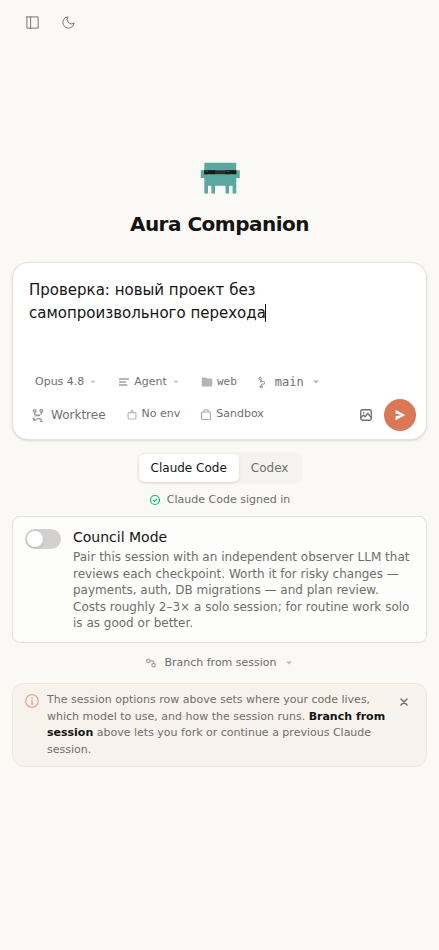
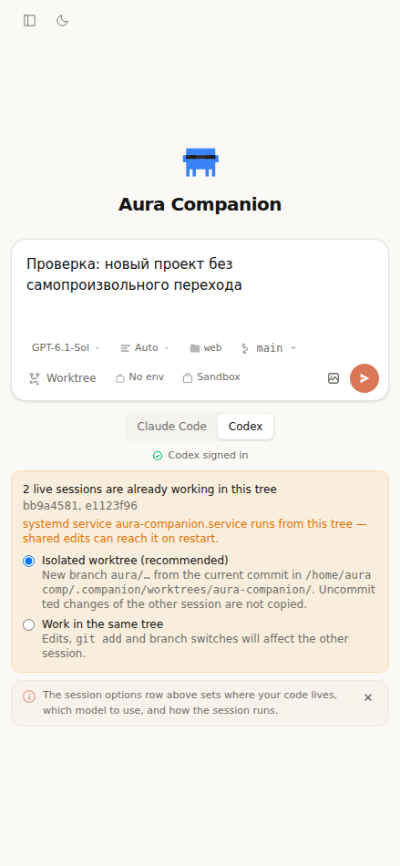

# Мобильная навигация и usability Aura — 2026-10-31

Пользователь сообщил: после «+» на iPhone форма новой сессии самопроизвольно сменяется пустым чатом. Два скриншота показывают именно переход Home → Session, а не только сброс выбранной папки. Проверка и исправления выполнены ИИ; на физическом iPhone этот код ещё не проверен.

## Исправленные сценарии

| Сбой | Эвристика / тяжесть | Доказательство | Исправление |
|---|---|---|---|
| Home заменяется фоновой живой сессией после загрузки списка | Контроль пользователя, 3/4, mobile web | App regression красный на старом коде; пользовательские скриншоты совпадают с таким переходом | Без сохранённого/явного выбора оставлять Home. Сохранённые сессии и явные deep links продолжают открываться |
| Обновление PWA перезагружает открытую форму/редактор | Предотвращение ошибок, 3/4, web/PWA | onNeedRefresh вызывал updateSW(true) без действия пользователя; regression тест | Объявлять новую версию и ждать Update. Текст предупреждает сохранить файлы; нет ложного обещания сохранности несохранённого ввода |
| Позднее завершение старого запуска переключает экран после ухода с формы | Контроль пользователя, 3/4, web | Отложенный createSessionStream + unmount: старый код вызывает navigateToSession, исправленный — нет | Привязать навигацию/прогресс к mounted-форме и homeResetKey; «+» очищает старый launch overlay. Уже созданная сервером сессия остаётся доступна в списке |
| Запоздалый /fs/home заменяет выбранный проект | Согласованность, 3/4, web | Выбрать /new-project до resolve /fs/home: старый код переключает на /default | Применять серверный default только к всё ещё пустому текущему cwd |
| Фоновое чтение файла затирает правку, начатую после отправки запроса | Предотвращение ошибок, 3/4, editor | Promise readFile + ввод во время ожидания: старый код заменяет draft на agent version | Повторно проверять dirty/path в момент ответа |
| Сохранение A меняет baseline уже открытого B | Видимость статуса / предотвращение ошибок, 3/4, editor | Медленная запись A + переход B: Save у B ошибочно активируется | Привязать результат сохранения к ревизии открытого файла |
| Создание Prompt/Environment/Sandbox без доступного имени на телефоне | Распознавание, 2/4, mobile web | Первый rendered scan: button-name, три страницы × две темы = шесть сигналов | Явные aria-label и aria-expanded, не зависящие от скрытого sm:inline текста |

В SessionEditorPane также задано имя редактируемой области CodeMirror. Компонент проверен отдельно; из этого не делается вывод, что он доступен во всех конфигурациях основного UI.

## Проверки

- Регрессии сначала воспроизведены на старом коде: автоматическое переключение App, автообновление SW, поздний cwd, старый launch, чтение/сохранение редактора.
- Компонентные наборы: HomePage, App, SW, SessionEditorPane, ClaudeMdEditor, Sidebar, Composer, FolderPicker, PromptsPage, EnvManager, SandboxManager, UpdateAvailableBanner; render, axe и действия пользователя.
- agent-browser: 439×950, нажатие «+», сохранение текста после прихода живого списка, Claude/Codex, сужение до 320 px без горизонтального overflow. Поиск и переключение экранов проверяются через read-only зеркало API: production mutations заблокированы; настоящие CLI не запускались.
- Rendered axe: начальная проверка девяти разделов × две темы нашла шесть сигналов; после исправлений выполняется расширенный повтор 11 разделов × две темы (Home, Settings, Agents, Runs, Prompts, Environments, Sandboxes, Diagnostics, Integrations, Sweep, Playground). Артефакт текущего запуска: `/tmp/aura-mobile-a11y-final/`.
- Полный suite и coverage запускаются с удалением унаследованных AURA_* timeout/catalog и PYTHONDONTWRITEBYTECODE overrides. Первый несани­тизированный запуск дал 9 окруженческих падений в двух неизменённых server suites; они не скрыты и не удалены. Текущий полный прогон: `/tmp/aura-mobile-full-clean.log`; итоговые проверки также обязательны в CI.
- Typecheck и production build выполнены; итоговое состояние проверяется CI перед merge.

## Ограничения приёмки

Это широкая проверка главных разделов и нескольких асинхронных гонок, а не доказательство usability каждого состояния приложения. Настоящие Safari/PWA, системная клавиатура, VoiceOver, фоновые ограничения iOS и реальный запуск обеих CLI требуют отдельной проверки на устройстве. Серверные ошибки учётной записи/лимиты модели здесь не объявляются исправленными.

Старый уже загруженный PWA-клиент может выполнить прежнее автообновление один раз, прежде чем получит исправленную сборку; новое поведение действует после её загрузки.

