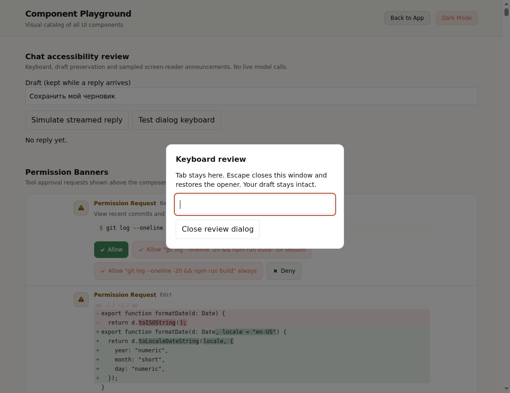

# Приёмка UI/UX: решения владельца

Инженерные изменения выполнены ИИ. Человеческое ревью ещё не проведено.
Сначала — `#/playground`, верхний блок **Chat accessibility review**.

| № | Сделано и как | Проверка владельцем / решение |
|---|---|---|
| 1 | Skills поставляются Claude/Codex; пользовательские файлы сохраняются. Пакет прошёл проверки обычной установки, существующего скилла и выключенного toolkit. | Оставить toolkit включённым по умолчанию? Рекомендация: да. |
| 2 | Диалоги удерживают Tab, закрываются Escape и возвращают фокус. Закрытые боковые панели исключены из Tab; действия доступны при фокусе; поле сообщения получило контрастную рамку. | В демо открыть окно, пройти Tab/Shift+Tab, нажать Escape. Фокус вернулся; черновик сохранился? |
| 3 | Ответы объявляются фрагментами ≤240 знаков, не чаще раза в 1,5 с; история, thinking и инструменты молчат. Прерванный ответ не называется завершённым. | Со скринридером запустить демо. Темп и объём удобны? Рекомендация: оставить 1,5 с / 240 знаков. Без скринридера этот пункт не считается проверенным. |
| 4 | Permission объявляется без перехвата фокуса; Alt+Shift+P переводит к запросу. Терминал имеет имя и режим скринридера; Escape внутри shell остаётся shell. | Принимаем сохранение черновика и shell-Escape? Рекомендация: да; закрывать терминал кнопкой. |
| 5 | Реальные дефекты исправлены; CI блокирует новые нарушения. В baseline осталось 9 нарушений только архивного лендинга: 7 FAQ без клавиатуры и 2 alert. | Оставить архив без изменений? Рекомендация: да, с явно принятой технической задолженностью. Это не исключения для действующего сайта. |
| 6 | Eval исключает ранние пробы и ошибки провайдера. Повторная Telegram-пара 2026-10-30 заблокирована требованием верификации Anthropic; два ответа с API Error изолированы вне корпуса и не вошли в отчёт. | Пройти https://portal.anthropic.com/verify и подтвердить, что Claude снова отвечает. Затем нужен N=10 в каждой ветке. Не принимать ошибку провайдера за результат модели. |
| 7 | Показатель «+30%» не заявлен: исходный парный аудит трёх неизменных UI не сохранён. Нужен новый воспроизводимый контрольный замер. | Подтвердить новый замер вместо неподтверждаемого исторического сравнения. Каждую находку оценивать «реальна / ложная», не зная ветки A/B; критерии ниже. |

Ответ можно дать одной строкой: `1,2,4,5 — принято; 3 — …; 6 — готово; 7 — новый замер`.

## Как принять «+30%», не подменяя результат

1. Зафиксировать одни и те же три UI: Aura, текущий auraco.space, согласованный Telegram Mini App. Сохранить снимки/код, URL, дату, ревизию и задачи пользователя.
2. Один и тот же модельный snapshot и промпт; отдельные чистые сессии без и с обогащением. Модель не знает результата другой ветки. После фиксации входов не менять правила/маркеры.
3. Объединить и обезличить находки A/B. Для каждой показать экран/элемент, воспроизводимый сценарий, нарушение и предлагаемое исправление. Владелец отмечает реальность/дубликат/ложное срабатывание.
4. `прирост = (подтверждённые_B / подтверждённые_A − 1) × 100%`; при A=0 процент не определён. Доля ложных срабатываний B не должна расти. Только после этого принимать или отклонять цель ≥30%.

Это пользовательская оценка качества, не автоматическая оценка по словам в ответе и не замена проверке реальным скринридером.

