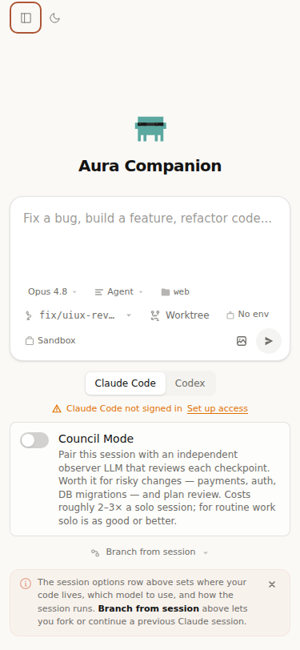

# UI/UX release follow-ups — 2026-10-30

The previous pair stopped after reviewing `5c688b1e..fdf78bde` (PRs #437,
#440–443). Its report is retained on the host at
`.council/review-output/2026-10-28-1958/FINAL-REVIEW.md`. No P1 remained.
This follow-up implements the confirmed release fixes. Implementation and
verification are by an AI agent; there has been no human code review.

| Finding | Resolution |
|---|---|
| F1 | Icon attribute expressions and JSX comments no longer become button labels; generic adjacent comments do not justify axe exclusions; a partial role/keyboard implementation still fires. Native table rows and APG listbox options retain their existing keyboard paths. Regression tests cover defects and legitimate alternatives. |
| F2 | Browser identity predicates are shared with server cleanup. Scan children inherit a unique ownership marker; cleanup checks UID, executable and kernel start time, then rechecks before signalling each PID. A dead daemon does not hide orphan Chrome processes. Sidecar location respects `AGENT_BROWSER_SOCKET_DIR`; signal handlers clean owned processes. Subprocess timeouts settle without waiting indefinitely for pipe closure. Synthetic `/proc` and real subprocess tests added. |
| F3 | Closed Sidebar and TaskPanel are inert. CI scans home, Agents, Runs and Playground in both themes. Rendered scan: PASS, 8 states, 0 violations. Manual checks and axe incomplete results remain explicitly unverified. |
| F4 | A PTY arriving after TerminalView unmount is killed immediately. Deferred-promise regression test added. |
| F5 | Light focus uses a darker semantic token; dark focus retains its existing colour. A contrast calculation checks >=3:1 against page, card, code and selected-row surfaces. |
| F6 | Selected execution is derived by sessionId + startedAt from the refreshed list. The actual disclosure button exposes aria-expanded. The expanded panel passes axe; polling updates its contents. |
| F7 | Report excludes 18 unisolated probes. New runs record their settings isolation. Font scaling evidence is checked in code, excluding prose/comments, and stored transcripts are regraded. Results are marker observations, not proof of improved usability. |
| F9 | Removed label/select-name exclusions from AgentsPage/AgentEditor scans. Named the import file input and scheduled date/time input. |
| F10 | Added baseline line-drift and message-only regression tests, actual entrypoint tree rendering and the terminal overlay axe scan. |

## Remaining acceptance work

F8 is the separate chat accessibility project identified by the original review.
It is not required to release the completed toolkit and checks. Its scope is:

- Streaming replies need a carefully throttled live announcement, without replaying
  full transcripts or tool output on every token.
- New permission requests need an accessible announcement and a deliberate focus
  policy that preserves the user's draft.
- AgentsPage/CreateIssueModal/ClaudeMdEditor/TerminalView overlays need consistent
  dialog semantics, Escape handling, focus containment and focus restoration.
- xterm needs screen reader mode and an accessible wrapper name.
- Hover-only actions need visible keyboard focus states; Composer focus needs a
  separate contrast check.

Acceptance must exercise both Claude and Codex message/permission flows, keyboard
navigation and a real screen reader, in addition to axe. Existing Playground
states must include each changed chat state.

The enrichment spec's human-confirmed +30% audit target remains unverified.
The Telegram reference changed after the stored N=10 cohort; a fresh paired run
is needed before claiming that revision improved model behaviour. The report
states both limitations explicitly; no fabricated evaluation pass is used as a
release gate.

## Verification

- Typecheck and production build pass.
- Full Vitest coverage run: 512 files passed, 1 skipped; 11,284 tests passed,
  6 skipped. Every changed frontend/server source exceeds the 80% line gate
  (new shared identity predicates: 100%). Additional final layout/entrypoint
  tests pass separately after the full run.
- Python checks: 103 passed, 30 subtests passed; strict UI/UX scan accepts only
  the 9 existing archived-landing rulings and reports no new findings.
- Rendered scan rerun with onboarding completed: all 8 route/theme states pass.
